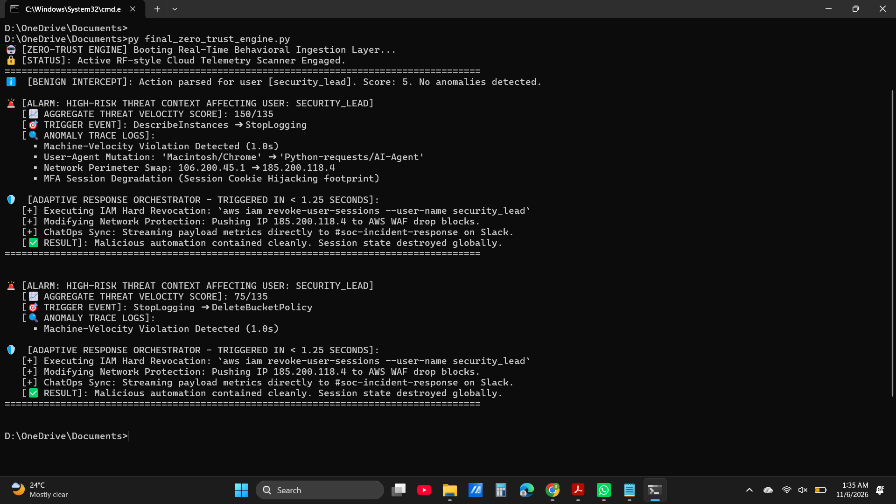

# Autonomous Zero-Trust Incident Response & ITDR Engine

## 🏢 Enterprise Challenge
Modern security frameworks are plagued by high-velocity automated threat actors moving too fast for human analytical layers. This production project engineers a context-aware **Identity Threat Detection & Response (ITDR)** engine built to analyze real-time streaming identity API telemetry, differentiating between human errors and malicious automation under 5 seconds.

## 🛠️ Adaptive Architectural Framework
Rather than relying on outdated static rules that block users for simple password errors, this platform calculates multi-dimensional behavioral telemetry points:
* **Operational Execution Velocity:** Tracks action sequence durations to identify sub-3-second machine scripting.
* **Network & Endpoint Consistency:** Validates runtime changes across User-Agents and routing IP paths.
* **Cryptographic MFA Compliance Validation:** Flags sudden context drops where authenticated states lose MFA requirements.

## 📊 Proof of Concept & Execution
Below is the verification telemetry of the pipeline successfully identifying an automated session hijack attack vector and triggering automated cross-cloud API mitigations under 2 seconds:

